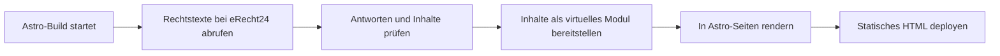

# Projektplan: Astro Rechtstexte für eRecht24

Status: Implementierung vorhanden, inzwischen auch mit Cloudflare-Adapter (`workerd`-Prerendering) und CI-Matrix (Stand 22. Oktober 2026). Die Testaufzählungen weiter unten stammen vom 1. Oktober und sind nicht vollständig; maßgeblich sind `CONTRIBUTING.md` und die Tests. Paket, Astro-Komponente und Beispielprojekte sind umgesetzt und mit simulierten Antworten geprüft. Das Paket ist noch nicht veröffentlicht; echte API- und Browserprüfung stehen aus.

## Ziel

Für unsere eigenen Flokani-Projekte entwickeln wir ein wiederverwendbares NPM-Paket, das Impressum, Datenschutzerklärung und optional die Datenschutzerklärung für Social Media während des Astro-Builds per PULL von eRecht24 abruft. Die Texte werden in die vorhandenen Astro-Seiten eingebunden und als statisches HTML veröffentlicht.

Besucher erhalten fertig erzeugte Rechtstextseiten. Der Abruf erfolgt in der Build-Umgebung und hängt nicht vom Aufruf einer Seite ab. Die Zugangsdaten bleiben in der Build-Umgebung und dürfen weder in das ausgelieferte HTML noch in Browser-JavaScript oder Build-Protokolle gelangen.

## Bestätigte Rahmenbedingungen und Kompatibilität

- Flokani hat die API-Vereinbarung mit eRecht24 abgeschlossen.
- Der eigene Developer-/Plugin-Key liegt noch nicht vor. Ob ein Projekt-API-Key für ein Testprojekt vorliegt, ist noch zu bestätigen.
- Die Entwicklung erfolgt zunächst gegen simulierte API-Antworten bzw. einen lokalen Testserver. Für die abschließende Prüfung gegen eRecht24 werden beide Schlüssel und passende Testdokumente benötigt.
- Die Zielprojekte verwenden überwiegend Astro 7.0 und höher. Die erste Paketversion unterstützt zunächst Astro 7.x mit `peerDependencies: { "astro": "^7.0.0" }`. Weitere Hauptversionen werden erst nach Kompatibilitätstests aufgenommen.
- Für die Entwicklung verwenden wir **Node.js 24 LTS, konkret 24.21.0**. Die Version ist in `.node-version` festgelegt und auf dem Mac über `fnm` installiert. `fnm use` aktiviert sie im Projekt; die globale Standardversion bleibt unabhängig davon.
- Die aktuelle Astro-Dokumentation nennt Node.js ab 22.12.0. Das Paket verwendet `engines: { "node": "^22.12.0 || ^24.0.0" }`. Die Testmatrix prüft Node 22.12.0 und Node 24.21.0; weitere Hauptversionen werden erst nach Tests aufgenommen.
- Das Entwicklungsprojekt verwendet Astro 7.3.5 und den Node-Adapter 11.1.6. Die untere Astro-Version 7.0.0 wird mit Adapter 11.0.0 geprüft. NPM-Abhängigkeiten sind durch `package-lock.json` reproduzierbar festgelegt.

## Name und Positionierung

| Verwendung | Festlegung |
|---|---|
| Produktname / README-Titel | **Astro Rechtstexte für eRecht24** |
| NPM-Paket | `@flokani.digital/erecht24-astro` |
| NPM-Organisation | `flokani.digital` |
| GitHub-Repository | `Flokani-Digital/erecht24-astro` |
| Eintrag im Framework-Verzeichnis | Astro integration by @Flokani-Digital – Flokani-Digital/erecht24-astro |
| Kurzbeschreibung | Impressum und Datenschutzerklärung aus eRecht24 automatisch beim Astro-Build einbinden. |
| Anbieter | Flokani GmbH |

Der Produktname beschreibt den Zweck und verwendet den Zusatz „für eRecht24“ entsprechend dem vorliegenden Namenshinweis von eRecht24:

> Sie dürfen an den Namen Ihres Plugins „für eRecht24“ oder „powered by eRecht24“ anhängen.

Der technische Name `erecht24-astro` benennt API und Framework und folgt dem Muster vergleichbarer Integrationen. NPM-Account und Organisation `flokani.digital` sind laut Bestätigung angelegt; der Paket-Scope lautet deshalb `@flokani.digital`. Vor der Veröffentlichung sind die Verfügbarkeit des vollständigen Paketnamens und die Veröffentlichungsberechtigung des verwendeten Accounts bzw. der CI zu prüfen. Der öffentliche Produktname verwendet weiterhin den Zusatz „für eRecht24“.

Die Benennung ist in Paketmetadaten, Imports, Integrations- und Modulnamen, Fehlermeldungen, Beispielen und Dokumentation vereinheitlicht. Das GitHub-Repository und die lokale Remote-Adresse verwenden `Flokani-Digital/erecht24-astro`.

## Technisches Konzept

Das Paket besteht aus einer Astro-Integration und einer Astro-Komponente zur Ausgabe der Rechtstexte. Die Integration übernimmt Abruf, Prüfung und Fehlerbehandlung. Die Komponente bindet die Inhalte in die vorhandenen Seiten und Layouts ein.



### Datenübergabe an die Komponenten

In `astro:config:setup` registriert die Integration ein Vite-Plugin für das virtuelle Modul `virtual:flokani-erecht24-astro`. Dieses Modul stellt die geprüften Rechtstexte als importierbare Daten bereit. Die Komponente `LegalText.astro` liest daraus, ohne selbst die API aufzurufen oder Zugangsdaten zu benötigen.

Für den Produktionsabruf ist der Astro-Hook `astro:build:start` vorgesehen. Die Integration lädt und prüft alle ausgewählten Dokumente, bevor das virtuelle Modul ihre Inhalte beim Bündeln einbettet. Es werden ausschließlich die benötigten Inhalte und die nicht vertrauliche Dokument-/Sprachauswahl serialisiert. Schlüssel, Request-Header und vollständige Konfigurations- oder Fehlerobjekte gehören nicht in das Modul.

Der Abrufzustand bleibt innerhalb der jeweiligen Integrationsinstanz. Die Umsetzung darf nicht voraussetzen, dass Integration und gebündelte Komponenten dieselbe globale Variable oder Modulinstanz verwenden. Die Reihenfolge von Abruf, Vite-Modulauflösung und Prerendering wird früh mit einem echten Astro-Build geprüft.

Jeder ausgewählte Dokumenttyp wird pro Build einmal geladen und anschließend wiederverwendet. Da eine API-Antwort `html_de` und `html_en` gemeinsam enthält, entstehen durch mehrere Sprachen oder Komponenten keine zusätzlichen Abrufe. Nur die ausdrücklich vorgesehenen Wiederholungsversuche bei vorübergehenden Fehlern können zusätzliche HTTP-Anfragen erzeugen.

### Verhalten je Astro-Befehl

| Befehl | Verhalten der Integration |
|---|---|
| `astro build` | Alle ausgewählten Dokumente für alle konfigurierten Sprachen frisch laden und prüfen, auch wenn einzelne Dokumente auf keiner Seite verwendet werden. Fehler brechen den Build ab. |
| `astro dev` | Beim ersten Bedarf an Rechtstexten laden und innerhalb der Integrationsinstanz im Arbeitsspeicher wiederverwenden. Gleichzeitige Zugriffe teilen denselben laufenden Abruf. Ein Neustart lädt erneut. Fehlende Schlüssel oder Abruffehler werden verständlich angezeigt; es werden keine Ersatztexte ausgegeben. |
| `astro sync` / `astro check` | Konfiguration und Typen prüfen bzw. bereitstellen; keine API-Anfragen und keine Zugangsdaten erforderlich. |
| `astro preview` | Das vorhandene Build-Ergebnis ausliefern; kein erneuter Abruf und keine Zugangsdaten erforderlich. |

Der Arbeitsspeicher für die Entwicklung ist kein persistenter Offline-Cache. Er wird bei einer neuen Integrationsinstanz verworfen.

### Seiten und Rendering

Die Projekte behalten ihre Seiten unter `/impressum/` und `/datenschutz/`. Bei Bedarf ergänzen sie eine Seite wie `/datenschutz-social-media/`, auf die ihre Social-Media-Profile verlinken können. Layout, Navigation und Gestaltung liegen beim jeweiligen Projekt. Auch in Projekten mit serverseitigem Rendering werden diese Rechtstextseiten vorgerendert.

Das virtuelle Modul koppelt das Paket an den Build-Ablauf von Astro und Vite. Dieses Risiko wird durch die begrenzte Astro-Versionsfreigabe und Tests in statischen sowie SSR-Projekten abgesichert. In Server-Builds können die öffentlichen Rechtstexte auch Bestandteil der Server-Dateien werden; Zugangsdaten dürfen dort nicht enthalten sein.

## Umfang der ersten Version

### Rechtstexte und Sprachen

- Impressum über `GET https://api.e-recht24.de/v2/imprint` abrufen.
- Datenschutzerklärung über `GET https://api.e-recht24.de/v2/privacyPolicy` abrufen.
- Optional die Datenschutzerklärung für Social Media über `GET https://api.e-recht24.de/v2/privacyPolicySocialMedia` abrufen.
- Social-Media-Datenschutz nur abrufen, wenn `privacyPolicySocialMedia` ausdrücklich in `documents` ausgewählt wurde. Ohne diese Auswahl ist kein entsprechendes Dokument im eRecht24-Projekt erforderlich.
- `languages: ["de"]` als Voreinstellung verwenden.
- Mit `languages: ["de", "en"]` beide Sprachen im selben Build unterstützen, sofern alle ausgewählten Dokumente in beiden Sprachen vorhanden sind.
- Die HTML-Felder `html_de` und `html_en` der API-Antworten verwenden.
- Die Sprache pro Komponente über `lang` auswählen. Ohne `lang` gilt die erste konfigurierte Sprache.
- Nicht konfigurierte Sprachen und nicht ausgewählte Dokumenttypen bei Verwendung in einer Komponente mit einer verständlichen Fehlermeldung zurückweisen.
- Fehlenden Inhalt in einer konfigurierten Sprache als Build-Fehler behandeln; kein stiller Wechsel auf eine andere Sprache.

Für alle ausgewählten Dokumenttypen gelten dieselben Sprach- und Fehlerregeln. Wird Social-Media-Datenschutz aktiviert, muss das entsprechende Dokument in allen konfigurierten Sprachen Inhalt liefern; andernfalls schlägt der Build fehl. Leere Dokument- oder Sprachlisten sowie unbekannte Werte werden bereits bei der Konfigurationsprüfung zurückgewiesen.

### Einbindung in Astro

- Integration in `astro.config.mjs` konfigurieren.
- Abgerufene Dokumente innerhalb eines Builds wiederverwenden.
- Eine Astro-Komponente `LegalText` für die Ausgabe bereitstellen.
- Vorhandene Seiten und Layouts des Projekts verwenden.
- TypeScript-Typen und Beispielprojekte für statische sowie serverseitig gerenderte Websites mit vorgerenderten Rechtstextseiten mitliefern.
- Interne Seiten-URLs mit abschließendem Slash verwenden.

### HTML-Ausgabe und Gestaltung

- Das HTML ausschließlich aus den festgelegten HTTPS-Endpunkten der eRecht24-API übernehmen. Eine andere Datenquelle ist nur innerhalb der Tests vorgesehen.
- Die Rechtstexte unverändert mit `set:html` ausgeben. Astro maskiert diesen Inhalt nicht automatisch; die API-Inhalte bilden damit eine ausdrücklich vertrauenswürdige Quelle für die HTML-Ausgabe.
- Keine Texte kürzen, Überschriften entfernen, Links umschreiben oder Inhalte durch eine automatische Bereinigung still verändern.
- Eine Prüfung nur auf `<script>` und `<iframe>` gilt nicht als vollständige HTML-Sicherheitsprüfung und wird nicht als solche zugesagt.
- Einen Wrapper mit `class`-Prop und passendem `lang`-Attribut bereitstellen. Die Projektgestaltung verwendet globale, auf diesen Wrapper begrenzte Selektoren bzw. `:global()`, damit sie auch das eingefügte HTML erreicht.
- Vorhandene Überschriften und mögliche Inline-Styles anhand echter API-Antworten prüfen. Das Beispiel-Layout muss dazu passen; die Verträglichkeit mit einer vorhandenen Content Security Policy ist im Zielprojekt zu prüfen.

### Zugangsdaten

eRecht24 verlangt zwei Schlüssel:

| Schlüssel | Herkunft | Bereitstellung |
|---|---|---|
| `eRecht24-api-key` | Kunde, eRecht24-Projekt-Manager, je Projekt | Umgebungsvariable `ERECHT24_API_KEY`, geheim |
| `eRecht24-plugin-key` | eRecht24 an Flokani, identifiziert das Plugin | fest im Paket (`src/plugin-key.ts`), öffentlich; optional per `ERECHT24_PLUGIN_KEY` überschreibbar |

Die API-Vereinbarung ist abgeschlossen; der eigene Developer-Key steht noch aus. Bis dahin bricht ein Abruf ohne `ERECHT24_PLUGIN_KEY` mit einem klaren Hinweis ab. Ein Live-Test mit den öffentlichen Demo-Schlüsseln aus der eRecht24-OpenAPI läuft bereits (`npm run test:live`).

Der Projekt-API-Key wird lokal über eine nicht versionierte Umgebungskonfiguration und im Deployment-System als Secret bereitgestellt. Er erhält keinen `PUBLIC_`-Präfix.

- `.env`-Dateien passend zum tatsächlichen Projekt-/Env-Verzeichnis und Ausführungsmodus laden, beispielsweise mit Vites `loadEnv` und dem Präfix `ERECHT24_`. In der Astro-Konfiguration darf nicht auf ein automatisches Laden dieser Dateien vertraut werden.
- Bereits gesetzte Umgebungsvariablen haben Vorrang vor Werten aus `.env`-Dateien. Nur die beiden benötigten Schlüssel übernehmen.
- Schlüssel erst prüfen, wenn ein Abruf erforderlich ist. `sync`, `check` und `preview` funktionieren ohne diese Werte.
- Die Authentifizierung über die Header `eRecht24-api-key` und `eRecht24-plugin-key` übertragen, niemals über URL-Parameter.
- Keine Schlüssel über `vite.define` oder das virtuelle Inhaltsmodul in erzeugten Code einsetzen.
- Keine vollständigen Fehler-, Request- oder Response-Objekte protokollieren. Fehlermeldungen kontrolliert erzeugen und bekannte Schlüsselwerte auch in extern gelieferten Hinweisen vor der Ausgabe entfernen.
- `.env`-Dateien und Testschlüssel vom veröffentlichten Paket ausschließen.

### Fehlerbehandlung

- Fehlende Schlüssel, nicht vorhandene Dokumente, ungültiges JSON, unerwartete Antwortstrukturen und leere Rechtstexte führen zu einem fehlgeschlagenen Build.
- Fehlende HTML-Felder sowie Inhalte, die nur aus Markup oder Leerraum bestehen, werden als unbrauchbar behandelt. Die Inhaltsprüfung darf das anschließend ausgegebene Original-HTML nicht verändern.
- Jeder Abrufversuch erhält 10 Sekunden Timeout einschließlich des Lesens des Antwortinhalts.
- Pro Dokument sind höchstens drei Versuche erlaubt: ein Erstversuch und maximal zwei Wiederholungen.
- Wiederholungen erfolgen nur bei vorübergehenden Netzwerkfehlern, Timeouts sowie HTTP 429, 500, 502, 503 oder 504. Zwischen den Versuchen wird mit steigender Wartezeit gewartet. `Retry-After` wird bei HTTP 429 berücksichtigt, mit höchstens 10 Sekunden Wartezeit; bei längerer Vorgabe bricht der aktuelle Build ab.
- Andere HTTP-Fehler, insbesondere 401, 403 und 404, sowie unbrauchbare Antworten werden nicht wiederholt. Fehlertexte nennen Dokumenttyp, gegebenenfalls Sprache und HTTP-Status, aber keine Schlüssel. Ein 401 wird nicht pauschal nur als falscher Schlüssel interpretiert, da auch eine abgelaufene Mitgliedschaft infrage kommt.
- API-`warnings` werden als lesbarer Text mit Dokumenttyp über den Astro-Logger ausgegeben. Warnungen allein brechen den Build nicht ab; fehlende oder unbrauchbare Inhalte bleiben Abbruchgründe.
- Produktionsbuilds verwenden frische Texte und greifen bei Fehlern nicht stillschweigend auf alte Inhalte zurück.

Scheitert der Abruf, wird kein neuer Stand veröffentlicht. Das Deployment-System muss so eingerichtet sein, dass das letzte erfolgreiche Deployment bei einem fehlgeschlagenen Build erreichbar bleibt.

## Entwurf der Paketschnittstelle

Die folgenden Beispiele entsprechen der implementierten Schnittstelle. Eine ausführliche Installations- und Entwicklungsanleitung steht in der [README](README.md).

### Astro-Konfiguration

```js
// astro.config.mjs
import { defineConfig } from "astro/config";
import rechtstexte from "@flokani.digital/erecht24-astro";

export default defineConfig({
  trailingSlash: "always",
  integrations: [
    rechtstexte({
      documents: ["imprint", "privacyPolicy"],
      languages: ["de"],
    }),
  ],
});
```

Die Integration lädt `ERECHT24_API_KEY` (und ein optionales `ERECHT24_PLUGIN_KEY`) nach den oben beschriebenen Regeln aus der Umgebung und lokalen `.env`-Dateien.

Für eine Website mit deutschen und englischen Rechtstextseiten wird `languages` auf `["de", "en"]` gesetzt. Beide Sprachfassungen stammen aus demselben Abruf je Dokumenttyp.

Für Projekte mit Social-Media-Datenschutzerklärung wird die Dokumentauswahl erweitert:

```js
documents: ["imprint", "privacyPolicy", "privacyPolicySocialMedia"]
```

### Verwendung in einer Seite

```astro
---
// src/pages/impressum.astro
import LegalText from "@flokani.digital/erecht24-astro/LegalText.astro";
import Layout from "../layouts/Layout.astro";

export const prerender = true;
---

<Layout title="Impressum">
  <LegalText type="imprint" lang="de" class="legal-text" />
</Layout>
```

Die Datenschutzerklärung wird entsprechend mit `<LegalText type="privacyPolicy" />` auf der Seite `/datenschutz/` eingebunden. Die Schnittstelle des Layouts richtet sich nach dem jeweiligen Projekt.

Bei konfiguriertem Englisch verwendet eine ebenfalls vorgerenderte englische Seite beispielsweise:

```astro
<LegalText type="privacyPolicy" lang="en" class="legal-text" />
```

Bei aktiviertem Social-Media-Datenschutz kann eine ebenfalls vorgerenderte Seite unter `/datenschutz-social-media/` die zusätzliche Komponente verwenden:

```astro
<LegalText type="privacyPolicySocialMedia" />
```

### Paketaufbau und Exporte

- Der Paketexport `.` stellt die Astro-Integration als ESM mit TypeScript-Deklarationen bereit.
- Der Export `./LegalText.astro` verweist auf die mitgelieferte Astro-Komponente.
- Typen für das virtuelle Modul werden über Astros Typ-Injektion oder eine mitgelieferte Deklaration bereitgestellt und mit `astro check` im installierenden Projekt geprüft.
- `files`, `exports`, `peerDependencies` und `engines` begrenzen den Paketinhalt und beschreiben die tatsächlich unterstützten Umgebungen.
- Die Installationsprüfung verwendet das mit `npm pack` erzeugte Archiv, damit fehlende Dateien oder Exporte nicht durch lokale Workspace-Verknüpfungen verdeckt werden.

## Aktualisierung und Betrieb

Eine Änderung im eRecht24-Projektmanager wird erst nach einem erfolgreichen Build und Deployment auf der Website sichtbar. Das Paket aktualisiert eine bereits veröffentlichte statische Website nicht selbstständig.

Zusätzlich zu Builds bei Projektänderungen sollen regelmäßige Builds im Deployment-System vorgesehen werden. Ein täglicher Build ist ein möglicher betrieblicher Ausgangspunkt, aber keine Garantie für die rechtzeitige Übernahme jeder Änderung. Fehlgeschlagene Builds müssen für die Verantwortlichen sichtbar sein. Da API-Warnungen allein den Build nicht abbrechen, müssen auch diese Hinweise im Betriebsablauf beachtet werden.

## Spätere Erweiterungen

- Ausdrücklich aktivierter lokaler Cache für die Entwicklung.
- Push-Benachrichtigungen von eRecht24 mit entsprechender Client-Registrierung.
- Deployment-Webhooks, die nach einer Benachrichtigung einen neuen Build auslösen.

Diese Funktionen gehören nicht zum Umfang der ersten Version. Der erste Schwerpunkt ist der zuverlässige PULL-Abruf von Impressum, Datenschutzerklärung und optionalem Social-Media-Datenschutz beim Build.

## Geplante Prüfung

### Automatisierte Prüfungen mit simulierten Antworten

- Erfolgreichen Abruf, fehlende Schlüssel, API-Fehler, Timeouts, ungültiges JSON, falsche Antwortstrukturen und fehlende Sprachinhalte prüfen.
- Leere Strings, reine HTML-Hüllen und Leerraum einschließlich geschützter Leerzeichen als unbrauchbare Inhalte erkennen; das Original-HTML bei erfolgreicher Prüfung unverändert ausgeben.
- Maximal drei Abrufversuche, Wartezeiten, Behandlung von `Retry-After` und unmittelbaren Abbruch bei dauerhaften Fehlern prüfen.
- Social-Media-Datenschutz mit aktivierter und deaktivierter Dokumentauswahl prüfen: Ohne Auswahl erfolgt kein Abruf; bei Auswahl werden vorhandene Texte gerendert und fehlende Dokumente oder Sprachinhalte als Build-Fehler gemeldet.
- Bei erfolgreichen Antworten genau einen Abruf je ausgewähltem Dokumenttyp nachweisen, auch bei DE und EN im selben Build sowie mehrfacher Komponentenverwendung. Wiederholungsversuche separat prüfen.
- Den Abruf aller konfigurierten Dokumente beim Build prüfen, auch wenn eine Seite sie nicht verwendet.
- Warnungen sichtbar ausgeben, dabei Schlüsselwerte entfernen und den Build bei ansonsten gültigen Inhalten fortsetzen.
- `.env`-Dateien, Ausführungsmodi, ein abweichendes Projektverzeichnis und den Vorrang vorhandener Umgebungsvariablen prüfen.
- Ohne Schlüssel und ohne Netz `astro sync`, `astro check` sowie `astro preview` eines vorhandenen Builds ausführen. Für `astro dev` den Abruf beim ersten Bedarf, gemeinsame laufende Anfragen und das Neuladen nach einem Neustart prüfen.

### Installation und Astro-Builds

- Das mit `npm pack` erzeugte Paketarchiv in zwei getrennten Beispielprojekten installieren: einem statischen Astro-Projekt und einem SSR-Projekt mit Node-Adapter und `prerender = true` auf den Rechtstextseiten.
- In beiden Projekten die Übergabe vom Build-Hook über das virtuelle Modul an die Komponenten sowie deutsche und englische Inhalte prüfen.
- Die Testmatrix mit Astro 7.x und Node 22 ab 22.12.0 sowie Node 24 durchführen. Eine angekündigte Versionsunterstützung gilt erst nach erfolgreicher Prüfung.
- Die öffentlich zugesagten Exporte, TypeScript-Deklarationen und den Import von `LegalText.astro` aus dem installierten Paket prüfen.
- Eindeutige künstliche Testschlüssel verwenden und sicherstellen, dass diese weder im gesamten Build-Verzeichnis einschließlich Server-Dateien und Source Maps noch in Logs oder im Paketarchiv erscheinen.
- Vorgerenderte Rechtstextseiten, interne Links und abschließende Slashes prüfen. Die Dokumentation muss auch für SSR-Projekte ausdrücklich `prerender = true` verlangen.

### Browser- und echte API-Prüfung

- Die gerenderten Seiten zuerst im In-App-Browser prüfen: Inhalt, Sprache, Überschriften und Gestaltung der per `set:html` eingefügten Texte.
- Nach Bereitstellung beider Schlüssel den Abruf der drei Dokumenttypen gegen ein geeignetes eRecht24-Testprojekt prüfen. Social-Media-Datenschutz und Englisch benötigen entsprechend angelegte Inhalte.
- Echte Antwortstrukturen, API-Warnungen, nicht vorhandene Dokumente und das gelieferte HTML mit den simulierten Testfällen abgleichen.
- Die Verträglichkeit des gelieferten HTML mit Layout und gegebenenfalls Content Security Policy des ersten Zielprojekts prüfen.

## Offene Punkte vor Produktiveinsatz und Veröffentlichung

- Verfügbarkeit von `@flokani.digital/erecht24-astro` und Veröffentlichungsberechtigung in der bereits angelegten NPM-Organisation `flokani.digital` prüfen.
- Developer-/Plugin-Key bereitstellen und Projekt-API-Key sowie Testdokumente bestätigen. Die API-Vereinbarung ist bereits abgeschlossen.
- Veröffentlichungslizenz festlegen.
- Zeitplan und Fehlerbenachrichtigung für regelmäßige Builds je Projekt festlegen.

## Umsetzungsstand und Prüfung

Vorhanden sind die TypeScript-Integration, der API-Abruf mit Timeout und Wiederholungsversuchen, Inhaltsprüfung, Warnungsausgabe, das virtuelle Inhaltsmodul und `LegalText.astro`. Zwei Beispielkonfigurationen zeigen statische Websites sowie SSR mit vorgerenderten Rechtstextseiten. `npm run dev` startet eine lokale Demo mit künstlichen Daten; echte Schlüssel werden dafür nicht benötigt.

Die NPM-Organisation `flokani.digital` und damit der Scope `@flokani.digital` sind festgelegt. Das Paket bleibt als `private: true` mit `UNLICENSED` markiert, bis Veröffentlichungsberechtigung und Lizenz geklärt sind. Es ist noch nicht veröffentlicht.

Automatisiert geprüft:

- Neun API-/Konfigurationstests unter Node 22.12.0 und 24.21.0: Dokumentauswahl, Sprachinhalte, unverändertes HTML, fehlende Schlüssel, ungültige Antworten, Warnungen, HTTP-Fehler, Retry-After und Timeout auch bei hängendem Response-Body.
- Installation eines echten `npm pack`-Archivs in getrennte statische und SSR-Testprojekte. Beide rendern Deutsch, Englisch und Social-Media-Datenschutz mit genau einem Abruf je Dokumenttyp.
- `astro sync` und `astro check` ohne Schlüssel; `astro preview` ohne erneuten Abruf; gemeinsame Dev-Anfragen, Wiederverwendung und neuer Abruf nach Neustart.
- Fehlgeschlagene Builds bei fehlenden Schlüsseln, HTTP 401, fehlender englischer Fassung und leerem Text. Warnungen werden ausgegeben, Schlüsselwerte darin entfernt.
- Eigenes Env-Verzeichnis, `--mode staging` und Vorrang gesetzter Umgebungsvariablen.
- Keine künstlichen Testschlüssel in Paketdateien, Logs und vollständigen Build-Verzeichnissen einschließlich SSR-Dateien. Statische Seiten enthalten die unveränderten Testtexte ohne Browser-JavaScript; interne Links bestehen den Trailing-Slash-Check.

Erfolgreich geprüfte Kombinationen für Installation, Astro-Befehle sowie statischen und SSR-Build:

| Node.js | Astro | Node-Adapter | Ergebnis |
|---|---|---|---|
| 22.12.0 | 7.0.0 | 11.0.0 | bestanden |
| 22.12.0 | 7.3.5 | 11.1.6 | bestanden |
| 24.21.0 | 7.0.0 | 11.0.0 | bestanden |
| 24.21.0 | 7.3.5 | 11.1.6 | bestanden |

Die Prüfungen wurden lokal auf macOS durchgeführt. Die einzelnen Zwischenversionen sowie andere Betriebssysteme wurden nicht separat getestet.

Verbleibende Prüfungen vor einem produktiven Einsatz:

- In-App-Browserprüfung: In der Entwicklungssitzung war kein Browser verfügbar. HTTP-Ausgabe und erzeugte HTML-Dateien wurden automatisiert geprüft; eine visuelle Kontrolle wurde nicht durchgeführt.
- Echte API-Antworten und Authentifizierung mit beiden Schlüsseln, echte Dokumente, Warnungen sowie HTML-/CSP-Verträglichkeit im ersten Zielprojekt.
- Zusätzliche Integrationsfälle für falsch verwendete Komponenten, Browser-Import des virtuellen Moduls und konfigurierte, aber auf keiner Seite verwendete Dokumente; diese ergänzen die vorhandenen Tests vor einer Veröffentlichung.
- Automatisierte CI-Ausführung der Testmatrix und Einbindung in das erste echte Flokani-Projekt.

## Referenzen

- [eRecht24 Swagger-Dokumentation](https://api-docs.e-recht24.de/)
- [eRecht24 OpenAPI-Spezifikation](https://api.e-recht24.de/v2openapi.json)
- [Astro Integration API](https://docs.astro.build/en/reference/integrations-reference/)
- [Astro: Umgebungsvariablen](https://docs.astro.build/en/guides/environment-variables/)
- [Astro: Upgrade auf Version 7](https://docs.astro.build/en/guides/upgrade-to/v7/)
- [Astro: Systemvoraussetzungen](https://docs.astro.build/en/install-and-setup/)
- [Astro: HTML-Ausgabe mit `set:html`](https://docs.astro.build/en/reference/directives-reference/#sethtml)
- [Node.js-Veröffentlichungen und LTS-Status](https://nodejs.org/en/about/previous-releases)

Der Repository-Stand und die offiziellen Dokumentationen wurden geprüft. Die technischen Festlegungen berücksichtigen die Empfehlungen aus der Planprüfung. Der beschriebene erste Implementierungsstand ist durch lokale automatisierte Tests mit simulierten API-Antworten abgesichert; dies ersetzt den ausstehenden echten API-Test nicht.
