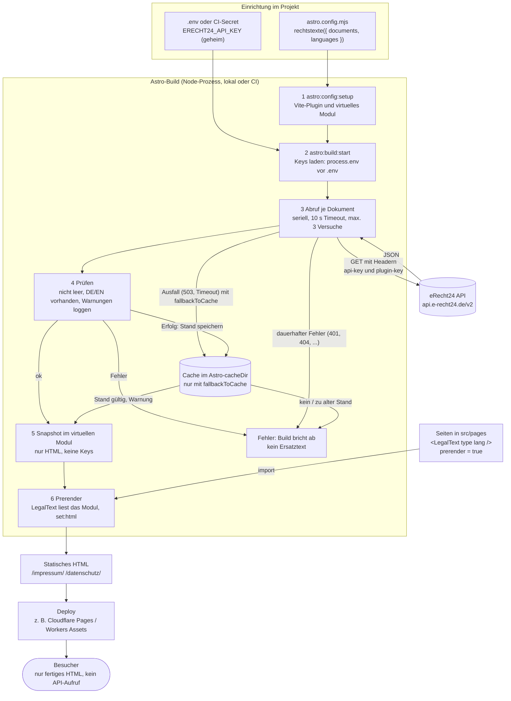
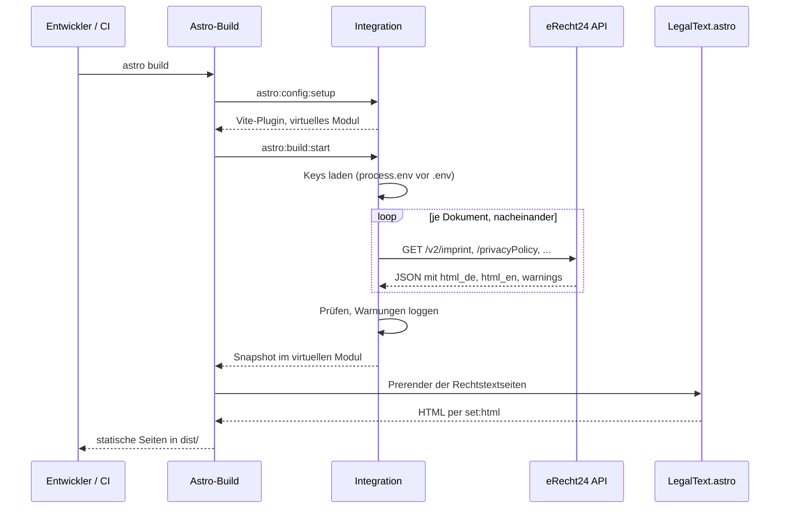

# Ablauf im Überblick

Wann, wo und womit passiert was? Die Diagramme zeigen den Weg von der Konfiguration bis zum Besucher. Details zu Wiederholungen und Fehlern stehen in [Abruf und Fehlerverhalten](abruf-und-fehler.md).

## Build

## Sequenz

## Verhalten je Astro-Befehl

| Befehl | Abruf | Keys nötig |
|---|---|---|
| `astro build` | frisch, alle Dokumente, einmal je Dokumenttyp; bei Ausfall optional letzter Stand | ja |
| `astro dev` | beim ersten Rendern, danach Cache bis zum Neustart | ja |
| `astro sync`, `astro check` | nein | nein |
| `astro preview` | nein (liefert den vorhandenen Build) | nein |

Eine Änderung im eRecht24-Projekt-Manager erscheint erst nach dem nächsten erfolgreichen Build und Deployment. Plane deshalb regelmäßige Builds ein.
